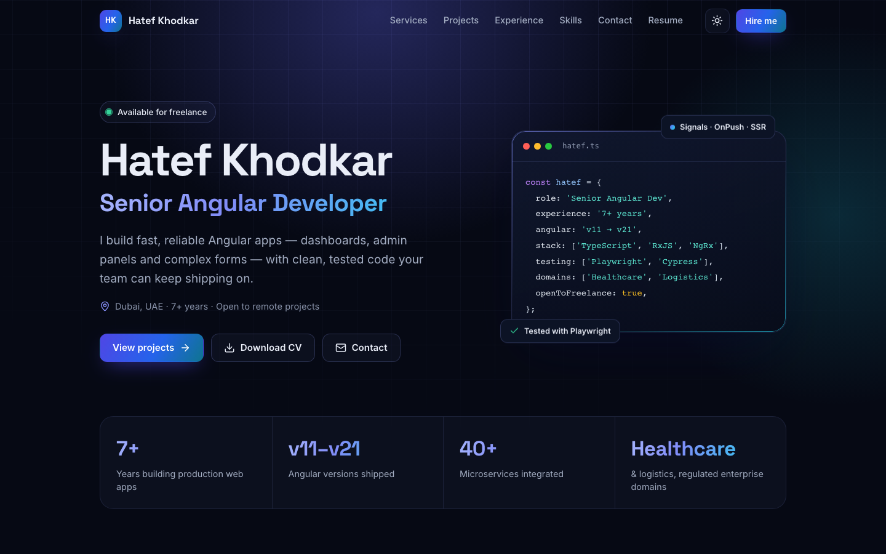

# Hatef Khodkar – Portfolio

Personal portfolio and online resume of **Hatef Khodkar**, Senior Angular Developer based in Dubai, UAE.

**Live site: [hkhodkar.github.io](https://hkhodkar.github.io/)**



## What's inside

- **Home** – hero, highlights, services, filterable project grid, experience timeline, skills and contact
- **Resume** (`/resume`) – web version of the CV with a print stylesheet and a PDF download
- **404** page for unknown URLs
- Dark and light themes (follows the system setting, remembers your choice)
- Every route is prerendered to static HTML, with per-page titles, meta descriptions, Open Graph / Twitter tags,
  JSON-LD, a sitemap and robots.txt

## Tech stack

- [Angular 21](https://angular.dev) – standalone components, signals, zoneless change detection, OnPush,
  built-in control flow, static prerendering (`outputMode: "static"`)
- SCSS design system with CSS custom properties (no UI library)
- Inline SVG icons, lazy-loaded routes and images, Google Fonts with `display=swap`
- [Vitest](https://vitest.dev) unit tests
- GitHub Actions + GitHub Pages

## Project structure

```
src/app/
  core/       config, theme, SEO and scroll services, navbar and footer
  data/       profile.ts (CV content) and projects.ts (portfolio projects)
  features/   home (and its sections), resume, not-found
  shared/     icon component, scroll-reveal directive, small utilities
public/       static files: CV PDF, project screenshots, favicons, og-image, sitemap
```

## Adding a project

1. Add a screenshot to `public/projects/<slug>.webp` – 16:10, about 1200×750 px (WebP keeps it light).
2. Append an entry to `PROJECTS` in [`src/app/data/projects.ts`](src/app/data/projects.ts):

```ts
{
  slug: 'my-new-app',                 // repo name, also the screenshot file name
  title: 'My New App',
  summary: 'One or two sentences about what it does.',
  highlights: ['Feature one', 'Feature two', 'Feature three'],
  tags: ['Angular 21', 'Signals', 'SCSS'],   // each tag becomes a filter chip
  demoUrl: 'https://hkhodkar.github.io/my-new-app/',
  codeUrl: 'https://github.com/hkhodkar/my-new-app',
  added: '2026-11-20',                // newest projects are shown first
},
```

3. Push to `main` – the site rebuilds and deploys automatically.

The project cards, filter chips and the resume's project list all update from this file.

## Configuration

`src/app/core/config.ts` holds the contact details and links. Set `UPWORK_URL` to an Upwork profile URL to show
"Hire me on Upwork" buttons; leave it empty to hide them.

## Development

Requires Node.js 20.19+, 22.12+ or 24+.

```bash
npm install
npm start                      # dev server at http://localhost:4200
npx ng test --watch=false      # unit tests
npm run build                  # prerendered site in dist/portfolio/browser
```

## Deployment

Pushing to `main` runs [`.github/workflows/deploy.yml`](.github/workflows/deploy.yml): install, test, build and
publish `dist/portfolio/browser` to GitHub Pages. The build also copies the prerendered 404 page to `404.html`, so
unknown URLs show the custom not-found page.

## License

Code is MIT licensed. The CV, text content and screenshots are © Hatef Khodkar.
